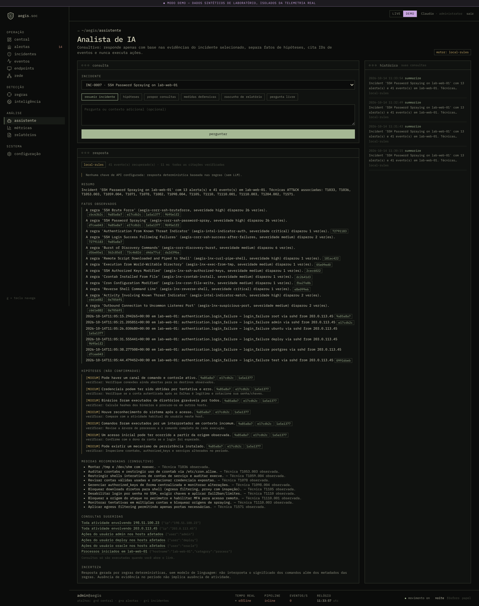

# Analista de IA

Código: `apps/api/src/aegis/services/assistant.py`, rota `apps/api/src/aegis/routers/assistant.py`,
tela `/assistant` e painel dentro de cada incidente.

O analista é **consultivo**: lê evidências de um incidente ou alerta, responde em pt-BR separando
fatos de hipóteses e cita os eventos usados. Ele **não tem ferramentas**, não executa nada e não
dispara ações de resposta.

## Tarefas

| `task` | Objetivo |
|---|---|
| `summarize` | resumo do incidente para passagem de turno |
| `explain_alert` | por que a detecção disparou e se a evidência a sustenta |
| `hypotheses` | hipóteses de investigação ordenadas por probabilidade |
| `queries` | buscas de eventos que confirmariam ou refutariam as hipóteses |
| `defenses` | medidas defensivas e de *hardening* para as técnicas observadas |
| `report` | rascunho da seção de achados de um relatório |
| `question` | pergunta livre do analista |

## Fluxo

```mermaid
flowchart LR
    Q[pergunta + incidente/alerta] --> R[recuperação<br/>escopo do caso]
    R --> E[evidência<br/>≤120 eventos, campos ≤400 chars,<br/>alertas, regras, diário]
    R --> K[RAG lexical BM25<br/>regras + docs/knowledge]
    E --> F[sinalização de prompt injection]
    E & K & F --> M{chave de API?}
    M -- sim --> L[Claude<br/>saída estruturada AnalystAnswer]
    M -- não / erro --> D[motor determinístico<br/>local-rules]
    L & D --> G[ground&#40;&#41; no servidor]
    G --> A[resposta + estatísticas<br/>de grounding]
    A --> H[(assistant_queries)]
```

1. **Recuperação com escopo:** só os eventos vinculados ao incidente/alerta, seus alertas,
   metadados das regras e o diário do analista. Sem incidente ou alerta a API recusa a
   pergunta. O modelo nunca recebe o banco inteiro.
2. **Base de conhecimento (RAG):** recuperação lexical ao estilo BM25 sobre descrições das regras
   e os playbooks em `docs/knowledge/*.md`. As fontes usadas aparecem na resposta.
   *Não* há embeddings/pgvector nesta versão (ver roadmap).
3. **Dados não confiáveis:** linhas de comando, nomes de arquivo e de usuário podem ser
   controlados por um atacante. A evidência vai como JSON dentro de um bloco `<evidence>`, com
   caracteres de controle removidos e campos truncados; o *system prompt* declara que esse
   conteúdo é dado, nunca instrução; um filtro de padrões (“ignore previous instructions”,
   “you are now”, `<system>`…) marca eventos suspeitos, e o console mostra esse aviso ao analista.
4. **Saída estruturada:** o esquema `AnalystAnswer` exige `summary`, `facts[]` (com
   `evidence_ids`), `hypotheses[]` (com `confidence` e `how_to_verify`), `recommendations[]`,
   `suggested_queries[]` (filtros estruturados) e `uncertainty` obrigatório.
5. **Grounding no servidor (`ground()`):**
   - citações a eventos que não estão na evidência recuperada são removidas;
   - “fatos” sem nenhuma citação válida são rebaixados a hipóteses de baixa confiança;
   - filtros de consulta fora da allow-list (`category`, `hostname`, `user`, `process`, `ip`,
     `port`, `q`) são descartados.
   As contagens (`dropped_citations`, `demoted_facts`, `dropped_filters`) são retornadas e salvas.
6. **Consultas sugeridas** viram links para `/events` com os filtros — o analista decide se roda.

## Modelos

- Com `AEGIS_ANTHROPIC_API_KEY`, usa a API da Anthropic (`AEGIS_ASSISTANT_MODEL`; o compose usa
  `claude-opus-5-5`) com saída estruturada validada por Pydantic. Recusas, erros de API e
  respostas sem estrutura caem para o motor determinístico com aviso explícito.
- Sem chave, o motor **`local-rules`** monta a mesma estrutura a partir dos metadados das regras,
  das táticas/técnicas ATT&CK observadas e da evidência. A interface identifica claramente que a
  resposta não usou LLM. É o modo usado nos testes e nas capturas de tela.

## Privacidade e custos

- Só a evidência do caso é enviada ao provedor, já com a redação de segredos aplicada pelo agente.
  Não habilite a chave se a telemetria não puder sair do ambiente.
- Cada pergunta registra engine, latência e estatísticas de grounding em `assistant_queries`
  (histórico em `GET /api/v1/assistant/history`).
- Requer a permissão `assistant:use` (analista ou administrador).

## Testes

`apps/api/tests/test_assistant.py` cobre: motor determinístico com citações válidas e
sinalização de *prompt injection* numa linha de comando maliciosa; recusa sem incidente/alerta;
RBAC (leitor não usa o analista); remoção de citações inventadas e de filtros fora da
allow-list; e o caminho do LLM com cliente simulado (grounding aplicado à resposta do modelo e
*fallback* para o motor determinístico em erro). Nenhum teste chama a API real da Anthropic.

## Limitações

- Recuperação lexical: perguntas com vocabulário muito diferente dos playbooks recuperam menos
  contexto.
- O filtro de *prompt injection* é heurístico; a defesa principal é estrutural (sem ferramentas,
  dados delimitados, grounding no servidor).
- A qualidade das hipóteses do motor determinístico é limitada às regras que dispararam.
