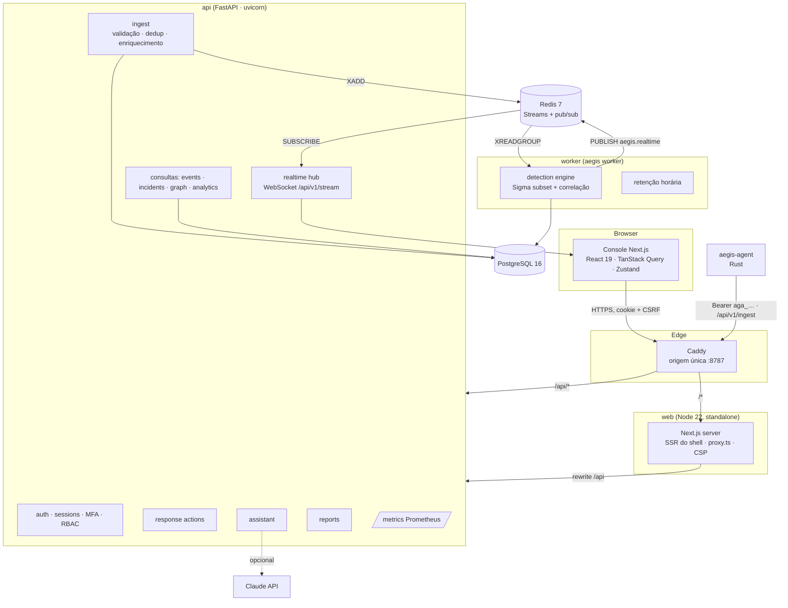
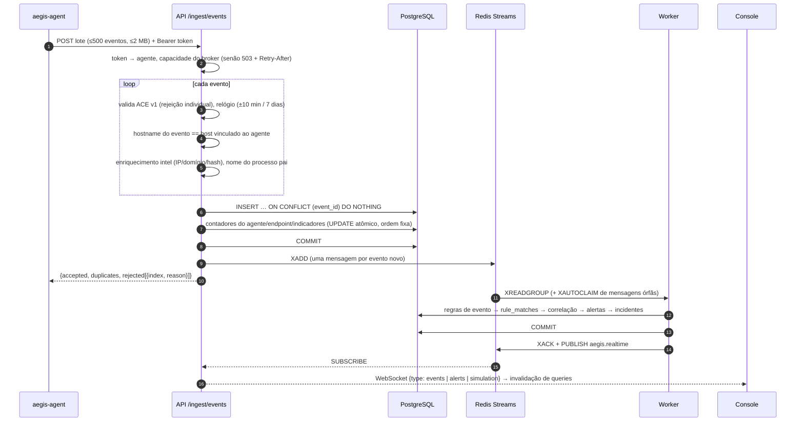
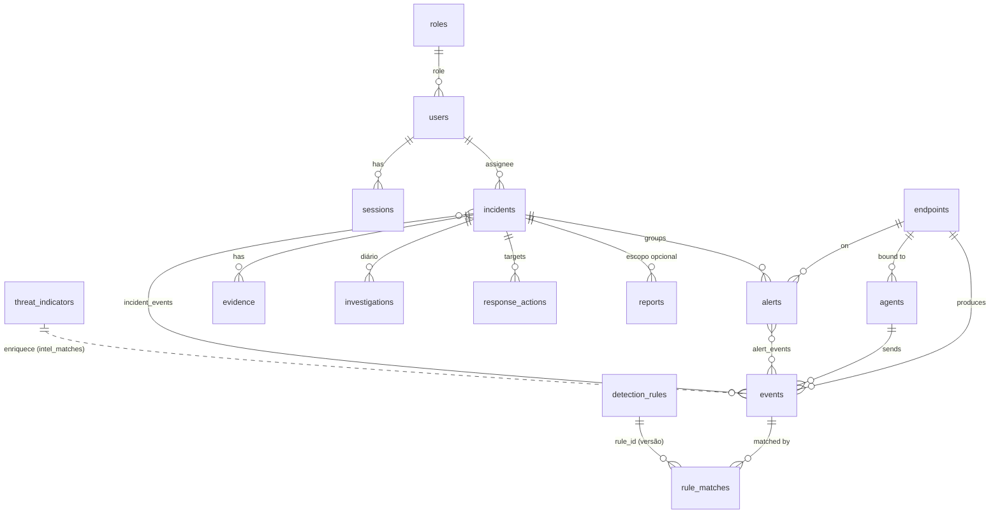

# Arquitetura

O AEGIS é um **monólito modular** em Python (API + worker que compartilham o mesmo pacote), um
console web em Next.js e um agente Linux em Rust. A escolha por um monólito está justificada no
[ADR 0001](adr/0001-modular-monolith.md): o domínio é coeso, o volume-alvo é de laboratório e
os limites entre módulos são mantidos por pacotes, não por rede.

## Componentes

| Componente | Código | Responsabilidade |
|---|---|---|
| API | `apps/api/src/aegis/main.py`, `routers/` | HTTP/WebSocket, autenticação, autorização, validação de entrada |
| Pipeline | `events/pipeline.py`, `events/broker.py` | validação ACE, dedup, vínculo de origem, enriquecimento, persistência, publicação |
| Detecção | `detection/` | compilação Sigma, avaliação, correlação, alertas, incidentes |
| Serviços | `services/` | investigação, intel, resposta, relatórios, analytics, analista de IA, auditoria, retenção |
| Segurança | `security/` | hashing, sessões, TOTP, RBAC, dependências FastAPI |
| Worker | `worker.py` | consome Redis Streams, roda detecção, retenção periódica |
| CLI | `cli.py` | `aegis migrate`, `create-user`, `rules`, `demo`, `worker`, `retention`, `export-*` |
| Web | `apps/web/src` | console (15 rotas), estado de UI, gráficos, grafos, tempo real |
| Agente | `agents/linux-agent` | coleta, redação, buffer, envio, heartbeats |

### Modos do pipeline

| Modo | Quando | Comportamento |
|---|---|---|
| `inline` (padrão) | desenvolvimento, testes, instalação mínima | a detecção roda no mesmo request, logo após a persistência |
| `broker` | Docker Compose | eventos persistidos são publicados no Redis Streams (`aegis.events`) e consumidos pelo grupo `detection` do worker |

## Fluxo de eventos

Propriedades garantidas e testadas (`apps/api/tests/test_vertical_slice.py`, `test_broker.py`):

- **Idempotência:** reenvios do mesmo `event_id` são contados como duplicados, nunca repetem
  detecção.
- **Fora de ordem:** a detecção usa `occurred_at`, não a ordem de chegada; janelas de correlação
  consultam `rule_matches` persistidos, então um evento atrasado ainda fecha uma correlação.
- **Rejeição parcial:** um evento inválido não derruba o lote; o agente descarta só os índices
  rejeitados.
- **Origem:** um agente não pode enviar eventos em nome de outro host (o evento é rejeitado;
  no heartbeat, HTTP 409).
- **Persistir antes de publicar:** se o Redis cair depois do commit, os eventos estão salvos e
  o worker reprocessa a partir das mensagens pendentes; se cair antes, a API responde 503 e o
  agente reenvia do spool (sem duplicar, por causa do `event_id`).
- **Backpressure:** quando o backlog do grupo passa de `AEGIS_STREAM_MAX_PENDING` (50 000), a API
  responde `503` com `Retry-After`; o agente guarda os lotes no spool em disco.
- **Concorrência:** a criação de endpoints usa `ON CONFLICT DO NOTHING` e os contadores são
  atualizados com `UPDATE … SET x = x + n` em ordem de chave fixa, evitando *deadlocks* (há
  teste de regressão com lotes concorrentes).

## Modelo de dados

Schema gerenciado pelo Alembic (`apps/api/src/aegis/migrations`). UUIDs como chave, timestamps
UTC com fuso, JSON (`JSONB` no PostgreSQL) para payloads.

Tabelas de apoio: `login_attempts` (limitação de tentativas), `audit_logs` (append-only pela
aplicação), `detection_runs` (execuções e latência), `intel_lookups` (cache de reputação, TTL
24 h), `simulations` (execuções do modo demonstração), `assistant_queries` (perguntas, respostas
e estatísticas de *grounding*).

Decisões relevantes:

- `events.event_id` é único → idempotência no banco, não em memória.
- `events.payload` guarda o evento ACE validado; colunas extraídas (`category`, `action`,
  `occurred_at`, `endpoint_id`, `process_pid`…) são indexadas para filtros e linha do tempo.
- `is_synthetic` em endpoints, agentes, eventos, matches, alertas, incidentes e indicadores marca
  dados de demonstração; o console separa os modos *live* e *demo* e o reset do modo demo apaga
  só esses dados.
- `detection_rules` é única por `(rule_id, version)`; matches e alertas registram a versão da
  regra que os gerou.
- Retenção: eventos mais antigos que `AEGIS_EVENT_RETENTION_DAYS` (30) são apagados pelo worker;
  eventos ligados a alertas/incidentes são preservados.

ClickHouse foi considerado e adiado ([ADR 0002](adr/0002-postgresql-first.md)).

## Contratos da API

- **Telemetria:** ACE v1 — JSON Schemas gerados em
  [`packages/event-schemas`](../packages/event-schemas/README.md). O agente Rust é validado
  contra esses arquivos em CI (job `contract`).
- **HTTP:** OpenAPI 3.1 gerado em [`packages/api-contracts/openapi.json`](../packages/api-contracts/openapi.json)
  (`aegis export-openapi`). Um teste falha quando o arquivo commitado diverge do código. Com a
  API rodando, a documentação interativa fica em `/api/v1/docs`.

Prefixo `/api/v1`. Resumo das rotas (75 operações):

| Grupo | Rotas principais | Permissão |
|---|---|---|
| `auth` | `POST /auth/login`, `/auth/mfa/verify`, `/auth/logout`, `GET /auth/me`, sessões, troca de senha, MFA setup/enable/disable | pública (login) / sessão |
| `ingest` | `POST /ingest/events`, `/ingest/heartbeat`, `/ingest/actions/{id}/result` | token de agente |
| eventos | `GET /events`, `/events/{id}`, `/events-histogram`, `/graph`, WS `/stream` | `telemetry:read` |
| endpoints/agentes | `GET/PATCH /endpoints…`, `/endpoints/{id}/process-tree`, `POST /agents`, `/agents/{id}/revoke` | `telemetry:read`, `agents:manage` |
| detecção | `GET /detections/rules…`, `PATCH /detections/rules/{id}`, `POST /detections/test`, `/detections/reload`, `GET /detections/runs` | `rules:read`, `rules:manage` |
| alertas | `GET/PATCH /alerts…`, `POST /alerts/escalate` | `alerts:triage` |
| incidentes | `GET/POST/PATCH /incidents…`, `/events`, `/process-tree`, `/graph`, `/export` | `incidents:write` |
| intel | `/intel/indicators` (CRUD, import), `/intel/lookup`, `/intel/summary` | `intel:read`, `intel:manage` |
| resposta | `/response/catalogue`, `/response/preview`, `/response/actions`, `/decision`, `/revert` | `response:request`, `response:approve` |
| IA | `GET /assistant/status`, `POST /assistant/ask`, `GET /assistant/history` | `assistant:use` |
| relatórios | `POST/GET /reports`, `/reports/{id}.json`, `/reports/{id}.pdf` | `reports:create`, `reports:read` |
| analytics | `GET /dashboard`, `/analytics` | `telemetry:read` |
| admin | `/admin/users`, `/admin/roles`, `/admin/audit` | `users:manage`, `audit:read` |
| demo | `/demo/scenarios`, `/demo/simulations`, `/demo/run`, `/demo/reset` | `demo:run` |
| ops | `GET /health`; `GET /metrics` (fora de `/api`, não roteado pelo gateway) | — |

Erros seguem `{"detail": …}` do FastAPI; validação retorna 422, permissão 403, conflito 409,
limite 413/429, backpressure 503 com `Retry-After`.

## Frontend

- **Rotas (15):** `/`, `/login`, `/dashboard`, `/alerts`, `/incidents`, `/incidents/[id]`,
  `/events`, `/endpoints`, `/network`, `/detections`, `/intelligence`, `/assistant`,
  `/analytics`, `/reports`, `/settings`.
- **Sessão:** o `proxy.ts` redireciona para `/login` quando não há cookie; o shell confirma a
  sessão em `/auth/me` antes de renderizar o conteúdo. A autorização real está no backend; o
  frontend só esconde controles sem permissão.
- **Dados:** TanStack Query com chaves por recurso; o hook de tempo real abre o WebSocket e
  invalida as queries afetadas. Zustand (persistido) guarda só preferências de UI: tema, modo,
  movimento reduzido, grafo 3D.
- **Visualização:** Recharts (séries e distribuições), Cytoscape (grafo 2D), React Three Fiber
  com layout de forças determinístico (grafo 3D, carregado sob demanda), árvore de processos e
  linha do tempo com *brush* próprios.
- **Segurança:** CSP sem `unsafe-eval` em produção, `frame-ancestors 'none'`, cabeçalhos de
  segurança, fonte auto-hospedada (nenhuma requisição a terceiros).
- **Acessibilidade:** navegação por teclado, atalhos `g` + tecla (`g d` central, `g a` alertas, `g i` incidentes…), foco visível,
  `prefers-reduced-motion` respeitado, layout responsivo até 360 px.
