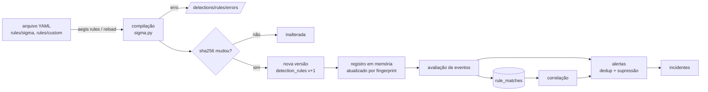

# Motor de detecção

Código: `apps/api/src/aegis/detection/` (compilador, registro, motor) e
`apps/api/src/aegis/services/alerting.py` (alertas e incidentes). Regras: `rules/`.

> O AEGIS implementa um **subconjunto** do formato Sigma. Ele **não** é compatível com todo o
> ecossistema Sigma; regras com construções não suportadas falham ao carregar, com mensagem
> explícita, em vez de nunca disparar em silêncio.

## Ciclo de vida de uma regra



- **Versionamento:** cada alteração de conteúdo cria uma nova linha em `detection_rules`
  (`rule_id`, `version`, `content_sha256`, `is_current`). Matches e alertas guardam a versão que
  os produziu; o histórico fica visível em `GET /api/v1/detections/rules/{rule_id}`.
- **Ativação:** `PATCH /detections/rules/{rule_id}` (`rules:manage`) liga/desliga com
  justificativa auditada. A ação de resposta `disable_rule` (com aprovação) também desativa a regra e pode ser revertida.
- **Recarga:** `POST /detections/reload` relê os arquivos; cada processo (API e workers) percebe
  mudanças pelo *fingerprint* do banco e recompila.
- **Teste sem efeitos colaterais:** `POST /detections/test` aceita uma regra salva ou um rascunho
  (`content`) e avalia contra eventos fornecidos ou contra a telemetria recente — é o que a aba
  “testar regra” do console usa.

## Subconjunto Sigma suportado

| Recurso | Suporte |
|---|---|
| `logsource` | combinações de `LOGSOURCE_MAP` (abaixo); outras falham ao carregar |
| Itens de detecção | mapas (AND), listas de mapas (OR), listas de palavras-chave |
| Valores | strings com curingas `*` e `?`, números, booleanos, `null`; listas = OR |
| Modificadores | `contains`, `startswith`, `endswith`, `all`, `re`, `cidr`, `gt`, `gte`, `lt`, `lte`, `exists`, `cased` |
| Condições | `and`, `or`, `not`, parênteses, `1 of x*`, `all of x*`, `1 of them`, `all of them` |
| Correlação | `event_count`, `value_count`, `temporal`, `temporal_ordered` com `group-by`, `timespan`, `condition` |
| **Não suportado** | `base64offset`, `windash`, `utf16*`, referências de campo, pipes de agregação legados (`| count()`), `near`, *placeholders*, pipelines pySigma |

Comparações são *case-insensitive* por padrão (como no Sigma); `cased` torna-as sensíveis.

### Mapeamento de campos

Regras podem usar nomes nativos ACE (`process.command_line`, `network.dst_port`, `auth.source_ip`,
`intel.matched`…) ou nomes Sysmon/Sigma traduzidos por `SIGMA_FIELD_MAP`:

| Sigma | ACE |
|---|---|
| `Image` | `process.executable` |
| `CommandLine` | `process.command_line` |
| `ParentImage` / `ParentName` | `process.parent_executable` / `process.parent_name` |
| `CurrentDirectory` | `process.working_directory` |
| `ProcessId` / `ParentProcessId` | `process.pid` / `process.ppid` |
| `User` / `LogonId` | `user.name` / `user.uid` |
| `sha256` | `process.hash_sha256` |
| `DestinationIp` / `DestinationPort` | `network.dst_ip` / `network.dst_port` |
| `SourceIp` / `SourcePort` | `network.src_ip` / `network.src_port` |
| `Protocol` / `Initiated` | `network.protocol` / `network.initiated` |
| `TargetFilename` | `file.path` |
| `Computer` | `host.hostname` |

Campos que não estão no mapa nem nos prefixos nativos fazem a regra **falhar ao carregar**.

### Mapeamento de `logsource`

| product / category / service | Categoria ACE | Ações |
|---|---|---|
| `linux` / `process_creation` | process | start |
| `linux` / `network_connection` | network | connect, accept |
| `linux` / `file_event` | file | create, modify, rename |
| `linux` / `file_create`, `file_change`, `file_delete` | file | create / modify, chmod / delete |
| `linux` / — / `auth` | authentication | login_success, login_failure |
| `linux` / `authentication` | authentication | + privilege_escalation |
| `aegis` / `process`, `network`, `file`, `authentication`, `system` | idem | todas as ações da categoria |

## Correlação

As regras base gravam cada par (regra, evento) em `rule_matches` — de forma idempotente — com os
campos de agrupamento necessários. A correlação consulta essa tabela durável, então funciona com
eventos fora de ordem, entre lotes diferentes e depois de reinícios do worker.

```yaml
title: SSH Brute Force
id: aegis-corr-ssh-bruteforce
correlation:
  type: event_count
  rules: [ssh_login_failure]       # `name:` da regra base
  group-by: [auth.source_ip, host.hostname]
  timespan: 5m
  condition: { gte: 10 }
level: high
tags: [attack.credential_access, attack.t1110.001]
```

| Tipo | Semântica |
|---|---|
| `event_count` | número de matches no grupo dentro do `timespan` satisfaz `condition` |
| `value_count` | número de valores distintos de `condition.field` (ex.: usuários testados num *password spray*) |
| `temporal` | todas as regras listadas dispararam no grupo dentro do `timespan` |
| `temporal_ordered` | idem, na ordem listada (ex.: falhas → sucesso de login) |

## Alertas e incidentes

- **Deduplicação/supressão:** a chave é `regra:escopo:modo` (escopo = host, ou grupo da
  correlação; modo = live/demo). Um novo match dentro de `AEGIS_ALERT_SUPPRESSION_MINUTES` (15)
  de um alerta aberto incrementa `hit_count` e anexa eventos em vez de criar outro alerta.
- **Agrupamento:** um alerta entra num incidente aberto do mesmo host cuja janela
  (`AEGIS_INCIDENT_GROUPING_MINUTES`, 30) se sobrepõe. Alertas `high`/`critical` abrem um novo
  incidente quando não existe nenhum; severidades menores apenas se juntam a um existente, para
  não inundar a fila.
- **MITRE ATT&CK:** tags `attack.tXXXX` e `attack.<tática>` viram técnicas e táticas no alerta e
  no incidente, exibidas no console e agregadas em analytics.

## Regras incluídas

20 regras: 11 em `rules/sigma` (formato Sigma, campos Sysmon) e 9 em `rules/custom`
(autenticação, intel e correlações). Exemplos: reverse shell, download canalizado para shell,
execução a partir de `/tmp`, minerador, servidor web gerando shell, persistência via cron e
`authorized_keys`, alteração de arquivos de conta, porta suspeita, *brute force* e *password
spray* SSH, sucesso após falhas, rajada de comandos de descoberta, match de indicador.

Elas foram escritas para este projeto, inspiradas em padrões públicos do SigmaHQ; não são cópias
de regras upstream.

## Escrevendo e testando uma regra

1. Crie `rules/sigma/<nome>.yml` (ou `rules/custom/`) com `title`, `id` único, `status`, `level`,
   `logsource`, `detection` e tags ATT&CK.
2. Valide: `cd apps/api && uv run aegis rules` (lista `ok`/`FAIL` com o motivo).
3. Adicione casos em `rules/tests/<id>.yml` — o teste `test_every_base_rule_has_regression_cases`
   exige pelo menos um:

   ```yaml
   rule: aegis-auth-remote-root
   match:
     - category: authentication
       action: login_success
       auth: { method: password, outcome: success, source_ip: 203.0.113.9, target_user: root, service: sshd }
   no_match:
     - category: authentication
       action: login_success
       auth: { method: password, outcome: success, source_ip: 127.0.0.1, target_user: root, service: sshd }
   ```

4. Rode `uv run pytest tests/test_rules_regression.py tests/test_sigma.py tests/test_correlation.py`.
5. Opcional: no console, **Regras → testar regra** contra a telemetria das últimas horas para estimar
   falsos positivos antes de habilitar.
