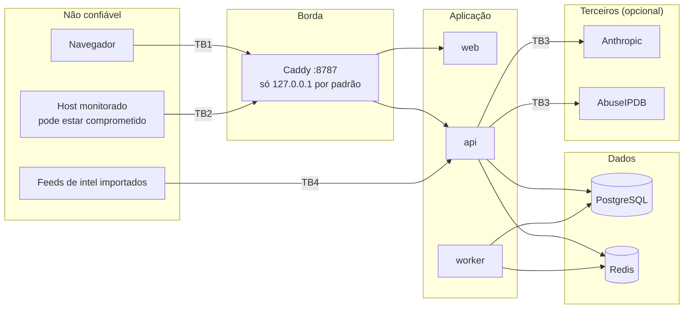

# Modelo de ameaças

Escopo: a stack AEGIS (gateway, web, API, worker, PostgreSQL, Redis), o agente Linux e as
integrações opcionais (Anthropic, AbuseIPDB). Método: STRIDE por fronteira de confiança, seguido
de um mapeamento resumido para o OWASP ASVS 4.0. Os controles citados existem no código; os
riscos residuais estão listados explicitamente.

## Ativos

| Ativo | Por que importa |
|---|---|
| Telemetria e evidências | podem conter nomes de usuário, IPs, caminhos e linhas de comando |
| Credenciais de usuários, sessões, segredos MFA | acesso ao console e às ações de resposta |
| Tokens de agente | permitem injetar telemetria em nome de um host |
| Regras de detecção | desativá-las cega a plataforma |
| Ações de resposta | afetam hosts e contas |
| Trilha de auditoria | responsabilização |
| Chaves de API de terceiros | custo e reputação |

## Fronteiras de confiança

**Premissa central:** o host monitorado pode estar comprometido. Tudo que vem do agente
(incluindo linhas de comando e nomes de arquivo) é dado controlado por um possível atacante.

## STRIDE

### TB1 — Navegador → console/API

| Ameaça | Controles | Residual |
|---|---|---|
| **S** — roubo/adivinhação de credenciais | argon2id; política de senha (comprimento, não conter o e-mail); limite de tentativas por usuário e por IP com bloqueio temporário; MFA TOTP com proteção contra reutilização do mesmo código; mensagens de erro genéricas | Atrás do gateway o IP visto pela API é o do proxy, então o limite por IP vira global; o limite por usuário continua efetivo |
| **S** — sequestro de sessão | token aleatório de 256 bits guardado só como HMAC-SHA256; cookie `HttpOnly`, `SameSite=Lax`, `Secure` configurável; expiração ociosa (30 min) e absoluta (12 h); rotação no login/MFA; revogação de sessões pelo usuário e pelo admin | `AEGIS_COOKIE_SECURE=false` no compose local (HTTP em localhost); ativar atrás de TLS |
| **T** — CSRF | token CSRF por sessão exigido em métodos de escrita (`X-CSRF-Token`), comparação em tempo constante; `SameSite=Lax` | — |
| **T** — XSS | React escapa saída; CSP `default-src 'self'`, `frame-ancestors 'none'`, sem `unsafe-eval` em produção; nenhum HTML de telemetria é renderizado como HTML | `script-src` ainda permite `'unsafe-inline'` (script de tema antes da hidratação e runtime do Next); *nonces* estão no roadmap |
| **T** — WebSocket cross-site | `/api/v1/stream` exige cookie de sessão ativa e `Origin` igual ao host ou à lista de CORS | — |
| **R** — negação de ações | `audit_logs` registra login, falhas, MFA, mudanças de usuário/regra, triagem, ações de resposta, com ator, IP e alvo; campos sensíveis são redigidos antes de gravar | A auditoria é *append-only* por convenção da aplicação, não por mecanismo do banco |
| **I** — vazamento de dados | RBAC no backend em toda rota (`require(Permission…)`); o frontend apenas esconde controles; senhas, tokens e segredos nunca são logados | — |
| **D** — abuso de recursos | limites de paginação/janela em consultas, limite de tamanho em uploads de regra e importação de indicadores | Sem *rate limit* global por usuário nas consultas |
| **E** — elevação de privilégio | papéis fixos com permissões explícitas; testes de RBAC por papel e rota (`test_rbac.py`); admin não pode remover o próprio papel de administrador | — |

### TB2 — Agente → ingestão

| Ameaça | Controles | Residual |
|---|---|---|
| **S** — agente falso | token `aga_…` exibido uma única vez, guardado como HMAC; revogação; agente vinculado ao host no primeiro contato | Sem mTLS; o token é um segredo *bearer* em arquivo `0600` |
| **S/T** — agente reportando por outro host | cada evento precisa ter o hostname do host vinculado; divergência é rejeitada | Um host comprometido pode mentir sobre si mesmo (limite inerente a telemetria de host) |
| **T** — eventos malformados/hostis | contrato ACE estrito (`additionalProperties: false`), limites de tamanho por campo, lote ≤500, corpo ≤2 MB, relógio ±10 min/7 dias | — |
| **R** — replays | `event_id` único: reenvio vira duplicado; `seq` por agente registrado | — |
| **D** — inundação | limites de lote/corpo; *backpressure* 503 com `Retry-After` no modo broker; rate limit e fila limitada no agente | Sem limite de taxa por agente no servidor |
| **E** — conteúdo malicioso afetando analistas ou o LLM | telemetria nunca é interpretada como HTML ou instrução; analista de IA trata evidência como dado, sinaliza injeções e não tem ferramentas | Filtro de injeção é heurístico |

### TB3/TB4 — Integrações externas

| Ameaça | Controles |
|---|---|
| SSRF via consulta de reputação | só um endpoint HTTPS fixo (AbuseIPDB), apenas IPs públicos válidos; a entrada do usuário nunca forma o host |
| Vazamento para terceiros | integrações desligadas por padrão; só a evidência do caso vai ao LLM |
| Intel envenenada | indicadores têm fonte, confiança e expiração; um match é sinal auxiliar e nunca declara comprometimento sozinho |
| Respostas de LLM manipuladas | `ground()` remove citações inexistentes, rebaixa fatos sem evidência e restringe filtros |

### Ações de resposta

| Ameaça | Controles |
|---|---|
| Execução remota arbitrária | **não existe**: catálogo fechado (`request_investigation`, `raise_incident_severity`, `disable_rule`, `revoke_user_sessions`, `isolate_host_lab`), parâmetros validados |
| Ação indevida por uma única pessoa | *preview* de impacto, justificativa obrigatória, aprovação por outro administrador (*four-eyes*, desativável só por configuração explícita) e confirmação digitada |
| Contenção fora do laboratório | `isolate_host_lab` só para endpoints com a tag `lab` (ou sintéticos); o agente incluído apenas confirma como `simulated` e não altera firewall |
| Ações irreversíveis | o catálogo marca cada ação como reversível ou não e o *preview* mostra isso antes da aprovação; `raise_incident_severity`, `disable_rule` e `isolate_host_lab` guardam o estado anterior e podem ser revertidas; tudo auditado |

### Dados e infraestrutura

| Ameaça | Controles | Residual |
|---|---|---|
| Segredos no repositório | nenhum segredo padrão; `AEGIS_SECRET_KEY` obrigatório; `.env` ignorado; compose falha sem segredos | — |
| Exposição de serviços internos | gateway publicado só em `127.0.0.1`; Postgres/Redis sem portas publicadas; `/metrics` fora do roteamento do gateway | Redis sem senha dentro da rede do compose |
| Segredo MFA em repouso | criptografado (Fernet com chave derivada de `AEGIS_SECRET_KEY`) | Rotação de `AEGIS_SECRET_KEY` invalida segredos MFA e tokens |
| Cadeia de suprimentos | lockfiles (`uv.lock`, `package-lock.json`, `Cargo.lock`); `pip-audit`, `npm audit`, `cargo audit`, CodeQL e Dependabot em CI; imagens com usuário não-root | Imagens base por tag, não por digest |

## Mapeamento OWASP ASVS 4.0 (resumo)

| Capítulo | Situação |
|---|---|
| V2 Autenticação | argon2id, política de senha, limite de tentativas, MFA TOTP com anti-replay, sem credenciais padrão |
| V3 Sessões | tokens server-side com hash, cookie seguro, expiração ociosa/absoluta, rotação, revogação |
| V4 Controle de acesso | RBAC no servidor, negação por padrão, testes por papel |
| V5 Validação | Pydantic estrito em todas as entradas; contrato ACE com `additionalProperties: false` |
| V7 Logs | logs JSON estruturados, auditoria com redação, sem segredos em logs |
| V8 Proteção de dados | dados sintéticos separados; retenção configurável; sem conteúdo de arquivos/pacotes |
| V9 Comunicações | agente recusa `http://` fora de redes de laboratório; TLS deve ser terminado no gateway em produção |
| V10 Código malicioso / V14 Configuração | auditorias de dependências, CodeQL, cabeçalhos de segurança, CSP |
| V13 API | CSRF, limites de tamanho, erros sem detalhes internos |

Não houve teste de intrusão independente. Este documento é uma análise de projeto, não um
certificado.
